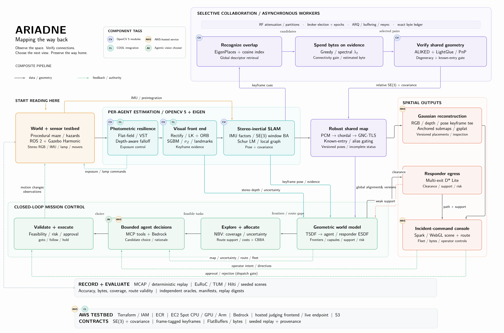

```
            
  :**888H:   .xH""                 @88>               dF
 X   `8▓▓8koXX8▓8       .u    .     %8P               '88bu.         u.    u.
'8hx  4▓█▓8 ?▓▓▓8     .d88B :@8c     .         d.     '*8▓▓88bu    x@88k u@88c.      .u
'8▓88 '▓█▓8 `8▓▓8    ="8▓▓8f8▓▓8r  .@88u     us888u.    ^▓*88▓8N  ^"8▓▓8""8▓▓8"   ud8888.
 %888>'▓▓▓8  8▓▓8      4▓█▓>'88"  ''8▓▓E` .@88 "8▓▓8"  be▓E "8▓8L   8▓▓8  8▓▓R  :888'8▓▓8.
   "8 '▓88"#"8▓▓8      4▓█▓> '      8▓▓E  9▓▓8  9▓▓8   8▓▓E  8▓▓E   8▓▓8  8▓▓R  d▓▓8 '88%"
  .-` X▓"    8▓▓8      4▓█▓>        8▓▓E  9▓▓8  9▓▓8   8▓▓E  8▓▓E   8▓▓8  8▓▓R  8▓▓8.+"
    .xh▓.    8▓▓8     .d▓▓▓L .+     8▓▓E  9▓▓8  9▓▓8   8▓▓E  8▓8F   8▓▓8  8▓▓R  8▓█▓L
  .H88▓▓8h.~`8▓▓8.>   ^"88▓8*"      8▓▓&  9▓▓8  9▓▓8  .8▓▓N..888   "*88*" 8▓88" '8▓▓8c. .+
 .~  `%88!` '888*~       "Y"        R888" "8▓8*d"8▓8"  `"888*""      ""   'Y"    "88▓▓8%
       `"     ""                     ""    ^Y""  ^Y'      ""                      "YP'

```

**Autonomous multi-agent visual SLAM, collaborative mapping and 3D reconstruction for GPS-denied,
communication-constrained disaster environments, and a route a person can follow back out.**

[**Operator console**](https://www.ariadne.cynicpixel.xyz/) · [**Technical report (PDF)**](submission/report/ariadne_technical_report.pdf)
· [**Video**](https://youtu.be/yrbcvQKnfkA) · [**Submission package**](submission/README.md) · [**Results**](docs/results/index.md)
· [**Docs map**](docs/README.md)

## Papers

| document | what it covers |
|---|---|
| [**Technical report (PDF)**](submission/report/ariadne_technical_report.pdf) | the full system: problem and users, architecture, OpenCV 5 implementation, AWS deployment, evaluation, failure cases, limitations, responsible use |
| [**Best Use of COOL evidence (PDF)**](submission/report/cool_evidence.pdf) | COOL version and AWS configuration, the reproducible stock-vs-COOL protocol on Graviton4, execution identity, Graviton results |
| [**Agentic Vision evidence (PDF)**](submission/report/agentic_vision_evidence.pdf) | the perception → decision → action loop, traces where OpenCV output changes the next action, task success, failure handling, human control |

LaTeX sources: [`docs/report/`](docs/report/).

## What Ariadne is

After a structural collapse, the spaces that most need searching are the ones people cannot safely enter: dark,
cluttered, cut off from GPS and from reliable radio. Ariadne sends a team of small stereo-camera agents in. They:
- map the space collaboratively over a lossy, byte-budgeted radio;
- refuse look-alike places that would tear the shared map apart;
- hand incident command two things: a 3D Gaussian-splat model of what they saw, and an egress route checked at
  responder width (a void a robot fits through is not a route for a person).

An LLM orchestrator on Amazon Bedrock chooses tasks from what the cameras found. Plain C++ validates every choice before
anything moves. A human approves anything risky.

Everything below the orchestrator is our own estimator stack, built on OpenCV 5 primitives:
- stereo-inertial VIO;
- windowed bundle adjustment;
- pose graphs with a robust back end and an optimality certificate;
- spectral collaboration under a byte budget;
- TSDF/ESDF mapping, next-best-view, CBBA allocation, D* Lite egress.

GTSAM and Ceres appear only as test oracles, never at runtime.

## Architecture



The diagram reads left to right:
- the world, then estimation on each agent;
- collaboration across agents (top), feeding a robust shared map;
- the spatial outputs (right);
- the closed mission loop (bottom), which moves the agents.

Every arrow is a typed contract: SE(3) poses with covariance, frame-tagged keyframes, and FlatBuffers messages whose bytes are counted at the serializer. Tags mark where OpenCV 5 (CV), the COOL integration (CL), AWS (AWS) and the agentic chooser (AV) come in. The full design is [`docs/architecture.md`](docs/architecture.md); each module below links to its own design document.

| module | code | what it does&nbsp;&nbsp;&nbsp;&nbsp;&nbsp;&nbsp;&nbsp;&nbsp;&nbsp;&nbsp;&nbsp;&nbsp;&nbsp;&nbsp;&nbsp;&nbsp;&nbsp;&nbsp;&nbsp;&nbsp;&nbsp;&nbsp;&nbsp;&nbsp;&nbsp;&nbsp;&nbsp;&nbsp;&nbsp;&nbsp;&nbsp;&nbsp;&nbsp;&nbsp;&nbsp;&nbsp;&nbsp;&nbsp;&nbsp;&nbsp;&nbsp;&nbsp;&nbsp;&nbsp;&nbsp;&nbsp;&nbsp;&nbsp;&nbsp;&nbsp;&nbsp;&nbsp;&nbsp;&nbsp;&nbsp;&nbsp;&nbsp;&nbsp;&nbsp;&nbsp;&nbsp;&nbsp;&nbsp;&nbsp;&nbsp;&nbsp;&nbsp;&nbsp;&nbsp;&nbsp;&nbsp;&nbsp;&nbsp;&nbsp;&nbsp;&nbsp;&nbsp;&nbsp;&nbsp;&nbsp;&nbsp;&nbsp;&nbsp;&nbsp;&nbsp;&nbsp;&nbsp;&nbsp;&nbsp;&nbsp; |
|---|---|---|
| **World and sensor testbed** | `simulator/`<br>`ros2/`<br>`python/dataset_tools/worldgen/` | Generates procedural collapsed-structure mazes with hazards. Gazebo Harmonic renders them headless (EGL) under ROS 2 Jazzy. Each agent carries 1280×720 stereo RGB, a synthesised 200 Hz IMU and a controllable spot lamp; kinematic movers drive the agents. A mission is rendered once into MCAP, then replayed. [simulation](docs/design/simulation.md) |
| **Photometric resilience** | `cpp/perception/`<br>`radiometric` `degradation` `exposure_control` | Flat-field correction, variance-stabilising denoising, normalisation of lamp falloff by depth, and exposure control. Darkness, dust and sensor noise are a seeded operator applied when the frame is read, so every baseline and ablation consumes identical pixels. [radiometric](docs/design/radiometric.md) |
| **Visual front end** | `cpp/perception/`<br>`features` `tracking` `stereo` `association` `dnn` | Stereo rectification, then FAST/ORB features tracked by forward–backward pyramidal LK. Depth comes from SGBM + WLS stereo, with a per-point depth σ. Lost tracks are re-associated. XFeat through `cv::dnn` is kept as an ablation. [perception](docs/design/perception.md) |
| **Stereo-inertial SLAM** | `cpp/slam/`<br>`odometry` `bundle_adjustment` `inertial` `loop_closure` | Keyframe VIO with Forster IMU preintegration, in a 10-keyframe Schur-complement Levenberg–Marquardt window built on `cv::detail::LevMarqBase`. When a keyframe leaves the window it is dropped and replaced by an odometry edge. Output: a pose and covariance for every keyframe, plus intra-agent loop closures. [local SLAM](docs/design/local-slam.md), [inertial](docs/design/inertial.md) |
| **Robust shared map** | `cpp/slam/`<br>`pose_graph` `robust` | A sparse SE(3) pose graph: chordal initialisation, then LM. Candidate loops pass a degeneracy gate, then PCM, then GNC-TLS. An SE-Sync-style certificate proves global optimality when it holds. The known-entry gate refuses loops that are geometrically consistent but aliased (look-alike places). [pose graph](docs/design/pose-graph.md), [robust back end](docs/design/robust-backend.md) |
| **Selective collaboration** | `cpp/collaboration/`<br>`retrieval` `candidate_selection` `broker` `protocol` `comms`<br>`cpp/runtime/agent/` | EigenPlaces descriptors (`cv::dnn`) find overlap between agents. Greedy / spectral-λ₂ selection spends the byte budget on the pairs that most improve the graph's connectivity. ALIKED + LightGlue + PnP verifies the shared geometry. An elected broker with epochs merges the maps. The radio model covers wall attenuation, partitions, ARQ and resync. In the live runtime this all runs in asynchronous worker processes. [collaboration](docs/design/collaboration.md), [retrieval](docs/design/retrieval.md), [spectral selection](docs/design/spectral-selection.md), [comms](docs/design/comms.md), [live collaboration](docs/design/live-collaboration.md) |
| **Geometric world model** | `cpp/planning/`<br>`volumetric` `frontier` | Voxel-hash TSDF → tri-state occupancy → incremental ESDF, at agent width and at responder width (0.40 m). It also computes 3D frontiers, traversability and a structural-risk proxy. [volumetric](docs/design/volumetric.md), [traversability and risk](docs/design/traversability-risk.md) |
| **Explore and allocate** | `cpp/planning/mission`<br>`cpp/runtime/live/` | Next-best-view by ray-cast information gain, with an energy-reserve rule; event-triggered CBBA assigns tasks across the fleet. The result is a set of feasible candidate tasks for each agent. [next-best-view](docs/design/next-best-view.md), [allocation](docs/design/allocation.md), [exploration](docs/design/exploration.md), [mission](docs/design/mission.md) |
| **Bounded agent decisions** | `python/orchestration/` | An LLM on Amazon Bedrock (Nova 2 Lite) chooses one of the planner's candidates through MCP tools, including `observe_image` on rendered decision maps and keyframes. Each call, choice and rationale goes into a JSONL decision trace. [agentic](docs/design/agentic.md) |
| **Validate and execute** | `cpp/runtime/tools/ariadne_live.cpp`<br>`simulator/plugins/kinematic_mover/` | C++ validates every choice for feasibility and risk. Approval-gated actions wait for the operator. The mover executes goto / follow / hold, and refuses any goal outside the ESDF safety envelope. [agentic](docs/design/agentic.md), [live runtime](docs/design/live-runtime.md) |
| **Responder egress** | `cpp/planning/route` | A responder-width lattice searched by multi-exit D* Lite, replanned incrementally as hazards appear. [egress](docs/design/egress.md) |
| **Gaussian reconstruction** | `python/reconstruction/`<br>`cpp/reconstruction/spool` | Each agent spools its keyframes (RGB, depth, pose). gsplat trains keyframe-anchored submaps on an AWS g4dn GPU, and moves each submap when its anchor pose is re-optimised. [reconstruction](docs/design/reconstruction.md) |
| **Incident-command console** | `python/operator_console/` | The web console: the splat scene (Spark / WebGL), the egress route, fleet state and the byte ledger, plus operator directives and approvals. It is hosted at the live endpoint. [live runtime](docs/design/live-runtime.md) |
| **Record and evaluate** | `cpp/runtime/`<br>`replay` `manifest` `metrics` `datasets`<br>`python/analysis/`<br>`infra/eval/` | MCAP record/replay with digest checks; loaders for EuRoC, TUM and Hilti; a run manifest for every run; metrics and gates. GTSAM (`python/oracle/`) is a test oracle only. [evaluation harness](docs/design/evaluation-harness.md) |
| **Core** | `cpp/core/` | Shared by every module: SE(3) geometry (left perturbation, one convention), FlatBuffers serialization, MCAP, IMU types, seeded randomness, time, uncertainty. |
| **AWS testbed** | `infra/` | Terraform, IAM, ECR, S3; EC2 spot launchers for CPU, GPU and Graviton; Bedrock access. Docker images are pinned by digest. [build](docs/build.md) |

## Headline results (measured; every number links to its run)

| subsystem | result | comparator |
|---|---|---|
| Inter-agent matching | ALIKED + LightGlue (through `cv::dnn`) loop verification: pose AUC@10° **0.607 vs ORB 0.284**, better on **11/11** EuRoC flights | matched baseline ([D63](docs/decisions.md)) |
| Stereo-inertial SLAM | Full system **at or better than ORB-SLAM3 on 7 of 11** EuRoC flights | published (ORB-SLAM3 T-RO 2021) · [runs](evaluation/runs/vio/euroc_full_aws/) |
| Place recognition | EigenPlaces R@1 **0.626** vs mean-bit 0.444 / random 0.167 (EuRoC, 297 queries); across agents in sim R@1 **0.75** | matched baseline · [runs](evaluation/runs/retrieval/) |
| Aliasing-proof merging | Known-entry gate: merged-map error **3.78 m → 1.5 cm**, **0 of 560** true loops rejected (pre-registered, 3 seeds) | matched (gate off vs on) · [runs](evaluation/runs/collaboration/known_entry_gate/) |
| ... on recorded live runs | Gate off: 32 of 32 geometry-verified loops were false and one robot ended **15.3 m** off. Gate on, same scene and seed: **8/8 refused**, every robot within **7.5 cm**. 250 s mission: **291** inter-robot edges kept, all robots merged, ≤ **0.22 m** | [gate off](evaluation/runs/collaboration/live_gate_off_20261024_c51ab2/) · [gate on](evaluation/runs/collaboration/live_gate_on_20261024_debba5/) · [250 s](evaluation/runs/live-agentic/demorec_250s_20261024_99ee9d/) |
| Robust back end | **Certified globally optimal** (SE-Sync's cost) on **7** public benchmark graphs; PCM→GNC survives up to **90 %** outliers | published (SE-Sync Table 1) · [runs](evaluation/runs/robust-backend/) |
| Pose-graph solver | Matches GTSAM on **100/100** synthetic graphs | oracle ([D52](docs/decisions.md)) |
| Task allocation | CBBA reaches **0.994** of the exact optimum (worst 0.983; the theoretical guarantee is ≥ 0.5) | exact oracle · [runs](evaluation/runs/planning/allocation_replay/) |
| Egress | **12/12** responder-width routes valid against ground truth; incremental D* Lite equals a fresh search on 180 obstacle-flip rounds | ground truth · [runs](evaluation/runs/egress/) |
| Agentic loop | Final integrated run: **80/80** Bedrock decisions validated, never chose an approval-gated option (**0/80**), and the mover refused 3 unsafe goals. Matched Bedrock-vs-classical pairs replay byte-identically | [evidence](submission/evidence/agentic-vision.md) |
| Reconstruction | Gaussian splat trained on AWS g4dn: **2.59 M** Gaussians from 3 agents. On the generated maze, held-out PSNR **24.36 dB** | [runs](evaluation/runs/reconstruction/) |
| Graviton4 | Native arm64 build passes **708/708** C++ tests; replay digests are identical to x86 | [evidence](submission/evidence/cool.md) |
| Cost | All **94** AWS runs (spot) for about **$4.8** of compute; a full collaboration sweep costs about $0.09 | [run index](submission/runs/RUNS.md) |

What does not hold up, and why, is listed in [docs/results/index.md](docs/results/index.md) ("do not claim") and in
[docs/failure-cases.md](docs/failure-cases.md).

## OpenCV 5 in the working path

| stage | OpenCV 5 | in Ariadne |
|---|---|---|
| Rectification, pyramids | `cv::stereoRectify`, `initUndistortRectifyMap`, `remap`, `buildOpticalFlowPyramid` | every frame |
| Tracking | `calcOpticalFlowPyrLK` (forward–backward), `FAST` + `ORB`, `findFundamentalMat` (USAC) | every frame |
| Stereo depth | `StereoSGBM`, `ximgproc` WLS; left–right LK on the rectified row | keyframes |
| Pose | `solvePnPRansac`, `solvePnPRefineLM`, `findEssentialMat`, `recoverPose` | per frame and per loop |
| Optimisation | `cv::detail::LevMarqBase` under our Schur-complement BA and pose-graph solvers | windowed BA, pose graphs |
| Learned features | `cv::dnn`: EigenPlaces (place recognition), XFeat (graph we assemble), `cv::ALIKED` + `cv::LightGlueMatcher` | keyframes, inter-agent verification |
| Restoration | flat field, VST denoising, exposure normalisation, CLAHE | radiometric front end |
| Mapping oracle | `cv::Volume` (TSDF/HashTSDF) | tests of our voxel-hash TSDF |
| Rendering | decision maps and keyframes rendered for the orchestrator's `observe_image` tool | agentic loop |

The pinned build is OpenCV 5.0.0 + contrib, built from source at fixed commits. Its build hash is recorded in every run
manifest. Details: [report §OpenCV 5](submission/report/ariadne_technical_report.pdf), [docs/build.md](docs/build.md).

## AWS

| service | role |
|---|---|
| EC2 spot, c7i.4xlarge | every replay, gate and collaboration sweep, plus the live lockstep runs; one instance per run, torn down after |
| EC2 spot, c8g.4xlarge (Graviton4) | native arm64 build, tests and timings; the COOL protocol (`./ariadne cloud cool`) |
| EC2 spot, g4dn.xlarge (T4) | Gazebo EGL rendering, Gaussian-splat training and rendering, the final integrated stack |
| Amazon Bedrock | Nova 2 Lite task chooser (EU inference profile), DeepSeek fallback in-region; tools exposed over MCP |
| S3 · ECR · IAM · SSM | run inputs and outputs (`runs/<id>/`), image registry, least-privilege runner role, no SSH |
| Terraform · Budgets | the whole account as code (`infra/aws/terraform`), with a credits budget and alerts |
| CloudFront · S3 | the hosted operator console frontend |

## Quick start

```bash
./ariadne build                        # pinned images: OpenCV 5 base, core (+ full C++ suite), simulator, orchestrator
./ariadne test                         # C++ suite + reconstruction, world-generation and determinism tests
./ariadne gate                         # end-to-end replay gate, one verdict
./ariadne run maze_short 6 200         # live closed loop in a seeded world (200 s)
./ariadne replay <run> <scene>         # replay twice, compare digests
./ariadne cloud e2e                    # the final integrated stack on AWS
```

[docs/build.md](docs/build.md) has every command, the pinned dependencies and the repository layout.

## Where things are

| | |
|---|---|
| [`submission/`](submission/README.md) | every competition deliverable, mapped to the requirements |
| [`docs/`](docs/README.md) | architecture, algorithms, design per subsystem, decision log (D1–D235), results, report sources |
| [`evaluation/runs/`](evaluation/README.md) | committed evidence for every claim, by subsystem |
| `cpp/` · `python/` · `ros2/` · `simulator/` · `configs/` · `infra/` · `tests/` | the system |

## Responsible use

Ariadne is decision support for incident command in spaces unsafe for people. It maps geometry, traversability,
uncertainty and routes, not people's identities. The language model chooses only among tasks the deterministic planner
proposes. Every choice is validated in C++, risky actions require human approval, and the responder route is computed
from observed 3D clearance independent of the model. Ariadne does not replace structural assessment or human authority.

## Team

Suvojit Das: design, engineering, evaluation. Built for the OpenCV AI Competition 2026 (powered by AWS).

## License

Ariadne's own code and documentation are released under the [MIT License](LICENSE). Third-party components keep their own licences: OpenCV (Apache 2.0), gsplat (Apache 2.0), and the pretrained models XFeat, ALIKED, LightGlue and EigenPlaces under their upstream licences (see [docs/algorithms.md](docs/algorithms.md)).
